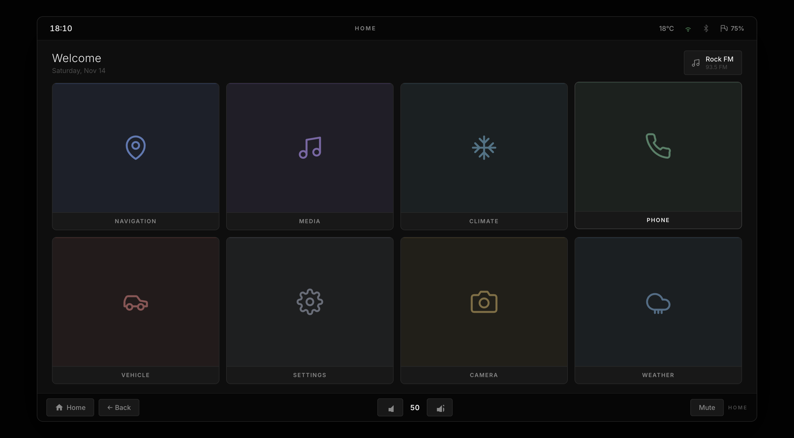
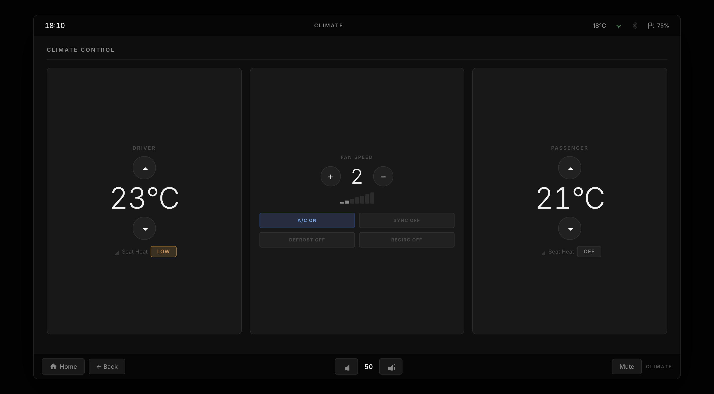
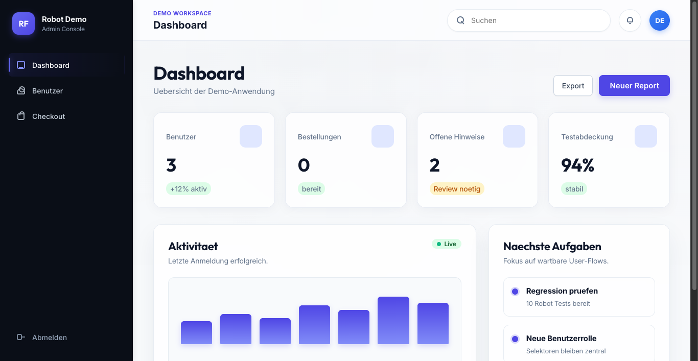
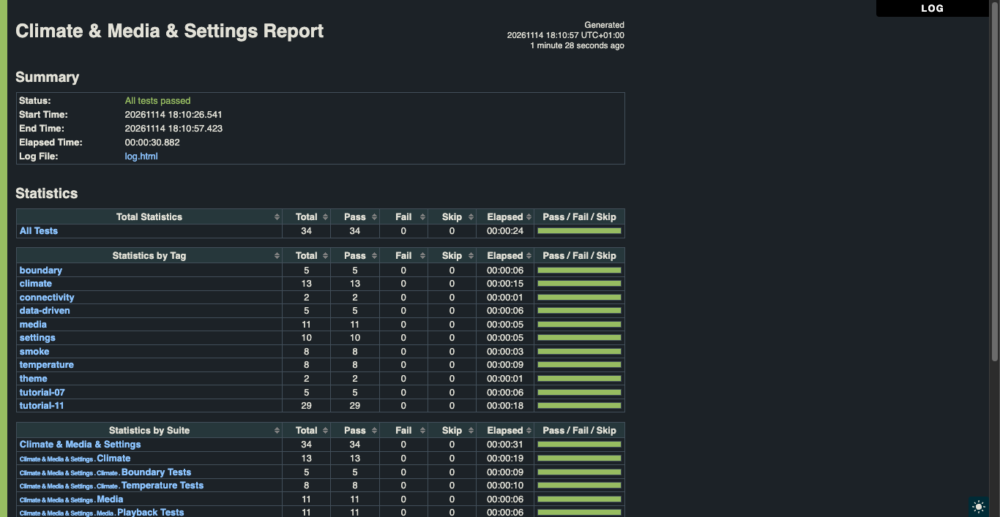

<div align="center">

# Robot Framework

**A practical, beginner-friendly documentation and automation project for learning and applying test automation with Robot Framework.**


<br>

[](https://robotframework.org/)
[](https://www.python.org/)
[](https://cagricatik.github.io/Robot-Framework/)
[](https://opencv.org/)

</div>

It is tailored for learners, QA engineers, and developers who want a practical path from Robot Framework basics to advanced real-world usage, including Page Object resources, an interactive automotive infotainment simulator, and custom computer vision integration.

---

## Overview

This project combines organized documentation (built with **Zensical**) with runnable Robot Framework test suites and demo applications:

- **Robot Framework Best Practices (`best-practices/`):** Clean project structure, Page Object resources, `data-testid` selectors, and a local Demo Admin web app (`login`, `user management`, `checkout`).
- **Interactive Learning Lab (`learning-lab/`):** Step-by-step exercises and domain suites (`climate`, `media`, `settings`, `suites`) with custom Python libraries.
- **Automotive Infotainment Simulator (`simulator/`):** Plain HTML/CSS/JS center-display simulator used as a test target across `project/`, `learning-lab/`, and `vision/`.
- **Computer Vision (`vision/` & `project/`):** OpenCV, EasyOCR, and YOLO11 object detection (`SimulatorVision.py`) for testing custom-rendered UIs.
- **Documentation (`docs/` + `zensical.toml`):** Fast static documentation site deployed via GitHub Actions to GitHub Pages.

---

## Screenshots

### Automotive Infotainment Simulator (`simulator/`)
| Home Screen | Climate Control |
| --- | --- |
|  |  |

### Best Practices Demo App & Robot Framework Report
| Demo Admin Console (`best-practices/web/`) | Robot Framework Execution Report |
| --- | --- |
|  |  |

---

## Project Structure

```shell
.
├── assets/screenshots/   # README preview screenshots
├── best-practices/       # Showcase for modern web automation & enterprise standards
│   ├── libraries/        # Custom Python libraries (TestDataGenerator)
│   ├── resources/        # Reusable Page Objects and browser keywords
│   ├── tests/            # Test suites (login, user management, checkout)
│   ├── variables/        # Environment variable files (local.py)
│   ├── web/              # Demo Admin web application
│   └── run_tests.*       # Test runner scripts (.ps1 / .bat)
├── dev/                  # Development cheat-sheets and keyword examples
├── docs/                 # Markdown documentation sources
├── learning-lab/         # Hands-on practice, libraries, and domain test suites
├── project/              # Core automation project (simulator & vision suites)
├── simulator/            # Automotive infotainment center display simulator
├── tutorials/            # Step-by-step tutorial markdown files
├── vision/               # YOLO11 object detection model, dataset & RF suite
├── requirements-docs.txt # Zensical documentation dependency
├── requirements-rf.txt   # Robot Framework, Selenium & Computer Vision dependencies
├── run.bat               # Windows quick-start script for Zensical docs
└── zensical.toml         # Zensical site & navigation configuration
```

---

## Getting Started

### Prerequisites

- Python 3.10+
- Google Chrome (for Selenium browser suites)
- Git

### 1. Create & Activate Virtual Environment

**macOS / Linux:**
```bash
python3 -m venv .venv
source .venv/bin/activate
```

**Windows (PowerShell):**
```powershell
python -m venv .venv
.\.venv\Scripts\Activate.ps1
```

### 2. Install Dependencies

For **Documentation (Zensical)**:
```bash
pip install -r requirements-docs.txt
```

For **Automation (Robot Framework, Selenium, OpenCV, EasyOCR)**:
```bash
pip install -r requirements-rf.txt
```

*(Optional)* For **YOLO11 Vision Tests (`vision/`)**:
```bash
pip install -r vision/requirements-vision.txt
```

---

## Running the Projects

### 1. Best Practices Suite (`best-practices/`)
Start the local web server for `best-practices/web/` and run the test suite:

**macOS / Linux:**
```bash
python -m http.server 8010 --bind 127.0.0.1 --directory best-practices/web &
SERVER_PID=$!
python -m robot --variablefile best-practices/variables/local.py --variable BASE_URL:http://127.0.0.1:8010 --variable SELENIUM_SPEED:0s --outputdir best-practices/results best-practices/tests
kill $SERVER_PID
```

**Windows (PowerShell):**
```powershell
cd best-practices
.\run_tests.ps1
```

### 2. Learning Lab Suites (`learning-lab/`)
Run the simulator-based domain suites (`climate`, `media`, `settings`):
```bash
python -m robot -v STEP_PAUSE:0 -v VIDEO_FPS:0 --outputdir learning-lab/results learning-lab/tests/climate learning-lab/tests/media learning-lab/tests/settings
```

### 3. Project Simulator Suite (`project/`)
Run the functional infotainment simulator tests:
```bash
python -m robot --outputdir project/results project/tests/simulator_tests.robot
```

### 4. Vision Suite (`vision/`)
```bash
python -m robot -d vision/results vision/tests/
```

---

## Documentation Workflow (Zensical)

The documentation source files live in `docs/` and are configured in `zensical.toml`.

1. Edit or add Markdown files inside `docs/`.
2. Update navigation in `zensical.toml` if needed.
3. Preview changes locally:
   ```bash
   zensical serve
   ```
4. Build static output into `site/`:
   ```bash
   zensical build --clean
   ```
5. Commit and push to `main` — `.github/workflows/deploy.yml` builds and deploys automatically to GitHub Pages.
