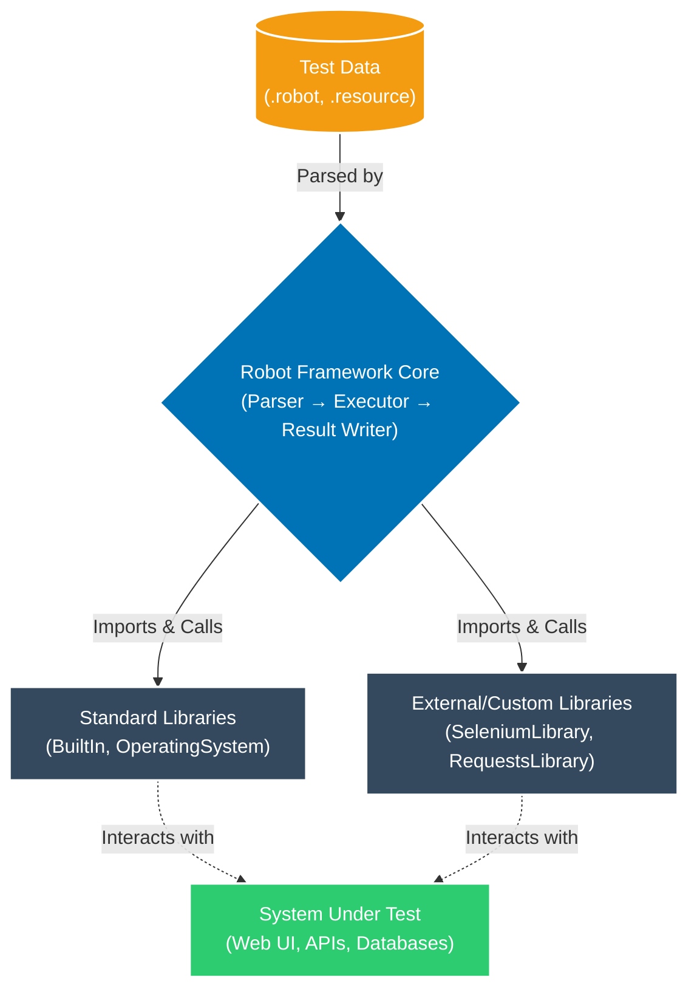

# Robot Framework Overview

## What is Robot Framework?

Robot Framework is a generic, open-source automation framework. It is primarily used for:

- **Test Automation**: For web, mobile, desktop, and API applications.
- **Robotic Process Automation (RPA)**: Automating repetitive business processes.

The framework is built on Python and is highly extensible through the use of libraries and human-readable keywords.

## History and Evolution

| Year | Milestone |
| ---- | --------- |
| 2004 | Concept created by Pekka Klarck — goal of a single, cross-platform automation framework |
| 2005 | Design published in Pekka Klarck's master's thesis; first version developed at Nokia Networks |
| 2008 | Version 2.0 released as open-source software |
| 2015+ | Rapid community growth; adoption in enterprise CI/CD pipelines |
| 2020 | Robot Framework 3.2 — major variable and keyword improvements |
| 2022 | Robot Framework 5.0 — `RETURN`, `TRY/EXCEPT`, `WHILE` loop, inline `IF` |
| 2023 | Robot Framework 6.x — `Tags` setting replaces `Force Tags`/`Default Tags` |
| 2024 | Robot Framework 7.0 — Native `VAR` syntax, JSON result format, dropped Python 3.7 support |

Today the project is hosted on GitHub and maintained by the Robot Framework Foundation, supported by a global community of contributors.

## Core Philosophy

Robot Framework is built around three guiding principles.

### 1. Human-Readable Tests

Test cases should be readable by anyone — developers, testers, and non-technical stakeholders alike. The keyword-driven approach means a test reads like a specification:

```robot
*** Test Cases ***
User Can Log In With Valid Credentials
    Open Browser To Login Page
    Submit Credentials    admin    secret
    Dashboard Should Be Visible
```

### 2. Technology Agnostic

The framework does not care about the technology under test. The same framework runs web UI tests (via SeleniumLibrary or Browser Library), REST API tests (via RequestsLibrary), database tests, desktop GUI tests, and SSH automation — all with the same syntax.

### 3. Layered Abstraction

Low-level technical operations are wrapped in reusable keywords. Test cases call high-level keywords; high-level keywords call lower-level keywords; the lowest level calls library functions. This layering keeps test cases clean and business-focused.

## Automation Approaches

Robot Framework supports three complementary test automation approaches.

### Keyword-Driven Testing

Test logic is expressed entirely through keywords. The test writer does not need to know the underlying implementation.

```robot
*** Test Cases ***
Search For Product
    Open Browser    https://shop.example.com    chrome
    Search For      laptop
    Results Should Contain    laptop
```

### Data-Driven Testing

The same test scenario runs repeatedly with different input data using templates.

```robot
*** Settings ***
Test Template    Login With Credentials Should Fail

*** Test Cases ***              USERNAME        PASSWORD
Invalid Username                wrong_user      correct_pw
Invalid Password                correct_user    wrong_pw
Both Fields Empty               ${EMPTY}        ${EMPTY}
```

### Behavior-Driven Development (BDD)

Robot Framework supports Gherkin-style `Given/When/Then` naming conventions. No special plugin is required — the words are simply part of the keyword name.

```robot
*** Test Cases ***
Successful Login
    Given the login page is open
    When the user submits valid credentials
    Then the dashboard should be displayed
```

## Architecture Overview



The core engine reads test data files, resolves keywords from libraries and resource files, executes them in order, and writes `output.xml`, `log.html`, and `report.html`.

## Resources

- [robotframework.org](https://robotframework.org) — official site, ecosystem index
- [Robot Framework GitHub Repository](https://github.com/robotframework/robotframework)
- [Robot Framework User Guide](https://robotframework.org/robotframework/latest/RobotFrameworkUserGuide.html) — comprehensive reference
- [Standard Library Documentation](https://robotframework.org/robotframework/) — BuiltIn, Collections, DateTime, OperatingSystem, and more

---

*Next: [About Robot Framework](02_about.md)*
