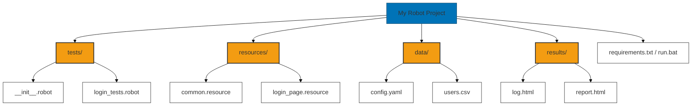

# Project Structure & File Anatomy

Robot Framework projects are typically organized into folders containing test suites, resources, and configuration files.

## File Extensions

Robot Framework uses two main file types:

- **`.robot`**: Used for test suites. These files contain actual test cases and can be executed directly.
- **`.resource`**: Used for reusable keywords and variables. These files cannot be executed directly but are imported into `.robot` files.

> [!TIP]
> Using `.resource` instead of `.robot` for shared files makes the project structure self-documenting — it is immediately clear that a `.resource` file is a library of helpers, not something you run.

## Typical Project Directory Structure



## The Four Sections of a Robot File

A Robot Framework file can contain up to four sections. Each section header uses three asterisks (`***`) on both sides.

| Section | Purpose |
| ------- | ------- |
| `*** Settings ***` | Imports, metadata, suite/test lifecycle hooks |
| `*** Variables ***` | File-level variable declarations |
| `*** Test Cases ***` | The actual test cases (`.robot` files only) |
| `*** Keywords ***` | User-defined keywords (both `.robot` and `.resource`) |

### 1. `*** Settings ***`

Imports libraries and resource files, adds suite documentation, and configures setup/teardown hooks.

### 2. `*** Variables ***`

Declares variables available throughout the file. Prefer this section over hardcoding values inside keywords.

### 3. `*** Test Cases ***`

Where the actual tests are defined. A test case consists of a name (at the beginning of a line) and a series of keyword calls (indented with at least two spaces).

### 4. `*** Keywords ***`

Custom sequences of existing keywords that simplify complex operations or promote code reuse.

## Fully Annotated Example

The following example shows a complete `.robot` file with all four sections and demonstrates real usage patterns:

```robot
# tests/login_tests.robot
# UTF-8 encoded — default for all Robot Framework files

*** Settings ***
Documentation       Test suite for user login functionality.
...                 Covers valid login, invalid credentials, and locked accounts.

Library             SeleniumLibrary
Resource            ../resources/common.resource
Resource            ../resources/login_page.resource

Suite Setup         Open Browser To Base URL
Suite Teardown      Close All Browsers
Test Setup          Navigate To Login Page
Test Teardown       Capture Page Screenshot On Failure

Metadata            Version    1.0
Metadata            Author     QA Team

*** Variables ***
${BASE_URL}         https://example.com
${BROWSER}          chrome
${VALID_USER}       admin
${VALID_PASS}       secret

*** Test Cases ***
Valid Login Navigates To Dashboard
    [Documentation]    Verifies that a user with valid credentials reaches the dashboard.
    [Tags]             smoke    login    positive
    Login As User      ${VALID_USER}    ${VALID_PASS}
    Page Should Contain    Welcome, ${VALID_USER}

Invalid Password Shows Error Message
    [Documentation]    Verifies that entering a wrong password shows a validation error.
    [Tags]             login    negative
    Login As User      ${VALID_USER}    wrongpassword
    Error Message Should Be Visible    Invalid username or password

*** Keywords ***
Login As User
    [Documentation]    Enters credentials and submits the login form.
    [Arguments]    ${username}    ${password}
    Input Text        id:username    ${username}
    Input Password    id:password    ${password}
    Click Button      id:login-btn

Error Message Should Be Visible
    [Arguments]    ${expected_message}
    Element Should Be Visible    css:.error-message
    Element Text Should Be       css:.error-message    ${expected_message}

Capture Page Screenshot On Failure
    Run Keyword If Test Failed    Capture Page Screenshot
```

## Syntax Rules

### Indentation

Robot Framework uses **spaces** for indentation — not tabs. The minimum is **two spaces** between a keyword call and its arguments, and between items on the same line.

```robot
*** Test Cases ***
Example
    Log    Hello World          # two spaces between keyword and argument
    Should Be Equal    1    1   # two spaces between each argument
```

### The 2-Space Separator Rule

Robot Framework uses **two or more spaces** (or a pipe `|`) to separate tokens. A single space is treated as part of the token value, not as a separator.

```robot
# WRONG — "Log Hello World" is treated as one keyword name
Log Hello World

# CORRECT — two spaces separate the keyword "Log" from its argument
Log    Hello World
```

### Continuation Lines

Long keyword calls or settings can be split across multiple lines using `...` as a continuation marker:

```robot
*** Settings ***
Documentation    This suite tests the login functionality
...              of the main application.
...              It covers both positive and negative scenarios.

*** Test Cases ***
Long Keyword Call
    Some Very Long Keyword Name
    ...    argument_one
    ...    argument_two
    ...    argument_three
```

### Comments

Use `#` for inline comments. Everything after `#` on a line is ignored by the parser.

```robot
*** Test Cases ***
Commented Example
    Log    Starting test    # this comment is ignored
    # This entire line is a comment
    Click Button    id:submit
```

## Suite Initialization Files

When a directory is treated as a test suite, you can add an `__init__.robot` file to that directory. This file sets up suite-level settings (e.g., `Suite Setup`, `Suite Teardown`, `Documentation`) that apply to all test files in the folder.

```text
tests/
├── __init__.robot          # suite-level setup for the entire tests/ folder
├── login_tests.robot
└── checkout_tests.robot
```

```robot
# tests/__init__.robot
*** Settings ***
Documentation    Main test suite for the Example application.
Suite Setup      Start Application Server
Suite Teardown   Stop Application Server
```

---

*Next: [The Settings Section](06_settings_section.md)*
