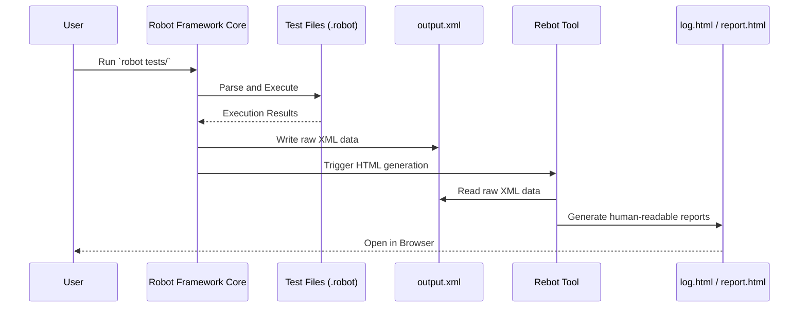

# Execution and Logging

Robot Framework provides powerful command-line options and an out-of-the-box reporting system that makes debugging straightforward.

## Basic Execution

```bash
# Run a single file
robot tests/login_tests.robot

# Run an entire folder
robot tests/

# Run with output in a dedicated directory
robot -d results tests/
```

## Advanced Execution Flags

### 1. Randomizing Order

To ensure test independence and avoid order-dependent failures, randomize execution order:

```bash
# Randomize the order of test cases within each suite
robot --randomize tests tests/

# Randomize suite execution order
robot --randomize suites tests/

# Randomize both
robot --randomize all tests/
```

### 2. Including/Excluding Tags

Tags allow you to run specific subsets of tests:

```bash
# Run only smoke tests
robot --include smoke tests/

# Exclude work-in-progress tests
robot --exclude WIP tests/

# Combine with AND (both tags required)
robot --include smokeANDcritical tests/

# Combine with OR (either tag matches)
robot --include smokeORcritical tests/

# Negate with NOT
robot --include smokeNOTslow tests/
```

> [!NOTE]
> Tag logic operators (`AND`, `OR`, `NOT`) must be uppercase.

### 3. Log Levels

Control the verbosity of the generated log:

| Level | Description |
| ----- | ----------- |
| `WARN` | Warnings and errors only |
| `INFO` | Standard execution info (default) |
| `DEBUG` | Detailed execution including all keyword calls |
| `TRACE` | Maximum detail — includes every argument and return value |

```bash
robot --loglevel DEBUG tests/
robot --loglevel TRACE tests/
```

Use `TRACE` when debugging unexpected argument values or return types.

### 4. Setting the Output Directory

Redirect all result files to a dedicated folder to keep the project root clean:

```bash
robot -d results tests/
robot --outputdir results tests/
```

### 5. Naming the Output Files

Customize the names of the generated files:

```bash
robot -d results \
    --output output.xml \
    --log log.html \
    --report report.html \
    tests/
```

### 6. Overriding Variables at the Command Line

Pass variable values directly on the command line to override those defined in the test file:

```bash
robot --variable BASE_URL:https://staging.example.com tests/
robot --variable BROWSER:firefox --variable TIMEOUT:30 tests/
```

This is especially useful in CI pipelines where environment-specific values differ between runs.

### 7. Dry Run — Syntax Validation

Run through the test structure without executing any keywords. Catches undefined keyword references and syntax errors:

```bash
robot --dryrun tests/
```

### 8. Running in Parallel with Pabot

For large test suites, use `pabot` to run suites in parallel:

```bash
pip install robotframework-pabot
pabot --processes 4 tests/
```

## Execution Flow



## Interpreting Result Artifacts

After every execution, Robot Framework generates three files in the output directory:

### 1. `log.html`

The most important file for debugging. It provides a hierarchical, step-by-step view of the execution.

- **Green**: Keyword passed.
- **Red**: Keyword failed.
- Expand any keyword to see its arguments, return value, and any nested keyword calls.
- Use the **search** bar at the top to filter by keyword name or message content.

### 2. `report.html`

A high-level summary suitable for sharing with stakeholders. Shows:

- Total pass/fail counts
- Pass rate percentage
- Statistics by tag
- Statistics by suite
- Elapsed time

### 3. `output.xml`

The raw execution data. This file is the source used to generate both HTML files. CI/CD tools (Jenkins, Azure DevOps, GitHub Actions) consume `output.xml` directly.

## Combining Reports with `rebot`

`rebot` post-processes one or more `output.xml` files and regenerates the HTML reports. This is useful for:

- **Merging** results from parallel runs into one report.
- **Regenerating** a report with different filtering settings without re-running tests.

```bash
# Merge multiple runs into one report
rebot -d results/merged results/run1/output.xml results/run2/output.xml

# Filter the merged report to only show failures
rebot --include FAILED results/output.xml
```

## CI/CD Integration

### GitHub Actions Example

```yaml
# .github/workflows/robot.yml
name: Robot Framework Tests

on: [push, pull_request]

jobs:
  test:
    runs-on: ubuntu-latest

    steps:
      - uses: actions/checkout@v3

      - name: Set up Python
        uses: actions/setup-python@v4
        with:
          python-version: "3.11"

      - name: Install dependencies
        run: pip install -r requirements-rf.txt

      - name: Run Robot Framework tests
        run: robot --outputdir results --loglevel DEBUG tests/

      - name: Upload results
        if: always()
        uses: actions/upload-artifact@v3
        with:
          name: robot-results
          path: results/
```

### GitLab CI Example

```yaml
# .gitlab-ci.yml
robot_tests:
  image: python:3.11
  script:
    - pip install -r requirements-rf.txt
    - robot --outputdir results tests/
  artifacts:
    when: always
    paths:
      - results/log.html
      - results/report.html
      - results/output.xml
```

## Debugging Failed Tests

1. **Open `log.html`**: Locate the red sections.
2. **Expand the failing keyword**: See the exact step that failed and the error message.
3. **Check arguments**: Use `--loglevel TRACE` to see the exact values passed to every keyword.
4. **Add temporary logging**: Insert `Log To Console    DEBUG: ${var}` to print variable states to the terminal in real time.
5. **Use `--dryrun`**: Rule out syntax issues before running the full suite.

### Useful Debugging Keywords

```robot
*** Test Cases ***
Debug Example
    ${value}=    Get Text    id:price
    Log    Raw price value: ${value}         # appears in log.html
    Log To Console    Price = ${value}       # appears in terminal immediately
    Log Variables                            # logs ALL current variables to log.html
```

## Quick Reference

| Flag | Short | Description |
| ---- | ----- | ----------- |
| `--outputdir DIR` | `-d DIR` | Set output directory |
| `--include TAG` | `-i TAG` | Include tests with tag |
| `--exclude TAG` | `-e TAG` | Exclude tests with tag |
| `--test NAME` | `-t NAME` | Run specific test case |
| `--suite NAME` | `-s NAME` | Run specific suite |
| `--loglevel LEVEL` | `-L LEVEL` | Set log verbosity |
| `--variable NAME:VAL` | `-v NAME:VAL` | Override variable |
| `--randomize TYPE` | | Randomize order |
| `--dryrun` | | Validate without executing |

---

*Next: [Variables Deep Dive](09_variables_deep_dive.md)*
