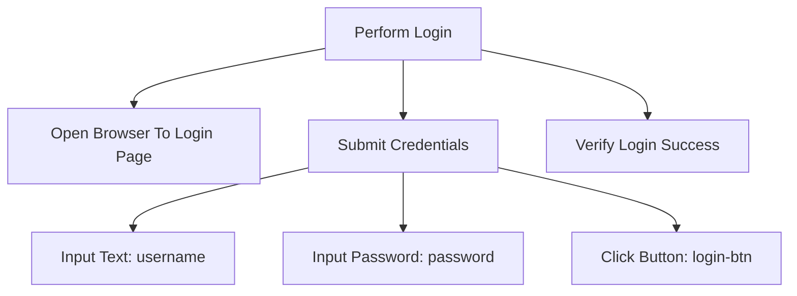

# User-Defined Keywords

User keywords are the building blocks of modular and readable Robot Framework tests. They allow you to combine multiple lower-level actions into a single, high-level business action.

## Creating a Keyword

Keywords are defined in the `*** Keywords ***` section.

```robot
*** Keywords ***
Log My Username and Password
    Log    Username: ${USER}[username]
    Log    Password: ${USER}[password]
```

## Keyword Settings

Each keyword definition can include the following settings:

| Setting | Purpose |
| ------- | ------- |
| `[Documentation]` | Describes what the keyword does (shown in log and IDE hover) |
| `[Arguments]` | Declares the keyword's parameters |
| `[Tags]` | Categorizes the keyword (useful for documentation generators) |
| `[Timeout]` | Maximum execution time |
| `[Teardown]` | Keyword to run after the main body, even if the body fails |
| `[Return]` | Legacy return syntax (use `RETURN` in RF 5+) |

```robot
*** Keywords ***
Open Login Page And Verify Title
    [Documentation]    Opens the login URL and asserts the page title.
    [Tags]             navigation    login
    [Timeout]          30 seconds
    Open Browser    ${BASE_URL}/login    ${BROWSER}
    Title Should Be    Login — Example App
```

## Nesting Keywords

You can call other keywords inside a user keyword, creating layers of abstraction:



```robot
*** Keywords ***
Perform Login
    Open Browser To Login Page
    Submit Credentials
    Verify Login Success

Submit Credentials
    Input Text        id:username    ${USERNAME}
    Input Password    id:password    ${PASSWORD}
    Click Button      id:login-btn

Verify Login Success
    Location Should Contain    /dashboard
    Page Should Contain        Welcome
```

## Keywords with Arguments

Arguments make keywords reusable across different scenarios.

### Defining Arguments

```robot
*** Keywords ***
Log Specific Data
    [Arguments]    ${data}
    Log    The data is: ${data}
```

### Multiple Arguments

```robot
*** Keywords ***
Login With Credentials
    [Arguments]    ${username}    ${password}
    Input Text        id:username    ${username}
    Input Password    id:password    ${password}
    Click Button      id:login-btn
```

### Default Argument Values

Provide a default using `${arg}=default_value`. Arguments with defaults are optional when calling the keyword.

```robot
*** Keywords ***
Open App In Browser
    [Arguments]    ${url}=${BASE_URL}    ${browser}=chrome    ${maximize}=${TRUE}
    Open Browser    ${url}    ${browser}
    Run Keyword If    ${maximize}    Maximize Browser Window
```

Calling the keyword:

```robot
*** Test Cases ***
Open With Defaults
    Open App In Browser                              # all defaults used

Open Custom URL
    Open App In Browser    url=https://staging.example.com    browser=firefox
```

### Variable-Length Arguments (`@{varargs}`)

Use `@{args}` to accept any number of positional arguments:

```robot
*** Keywords ***
Log All Values
    [Arguments]    @{values}
    FOR    ${v}    IN    @{values}
        Log    ${v}
    END
```

```robot
*** Test Cases ***
Pass Many Args
    Log All Values    apple    banana    cherry    date
```

### Keyword Arguments (`&{kwargs}`)

Use `&{kwargs}` to accept named arguments as a dictionary:

```robot
*** Keywords ***
Create User With Options
    [Arguments]    ${username}    &{options}
    Log    Creating ${username}
    Log    Role: ${options.get('role', 'user')}
    Log    Email: ${options.get('email', 'no-reply@example.com')}
```

```robot
*** Test Cases ***
Create Admin User
    Create User With Options    alice    role=admin    email=alice@example.com
```

## Returning Values

### `RETURN` (Robot Framework 5+, standard in 7+)

Use the `RETURN` statement to return a value from a keyword. Execution of the keyword stops at `RETURN`.

```robot
*** Keywords ***
Get Page Title Text
    ${title}=    Get Title
    RETURN    ${title}

Get Cart Item Count
    [Arguments]    ${expected_min}=0
    ${count_text}=    Get Text    css:.cart-count
    ${count}=         Convert To Integer    ${count_text}
    IF    ${count} < ${expected_min}
        Fail    Cart has fewer items than expected: ${count} < ${expected_min}
    END
    RETURN    ${count}
```

Calling a keyword that returns a value:

```robot
*** Test Cases ***
Verify Page Title
    ${title}=    Get Page Title Text
    Should Contain    ${title}    Dashboard
```

### `[Return]` (Legacy, Deprecated)

```robot
*** Keywords ***
Get Current Timestamp
    ${ts}=    Get Current Date    result_format=epoch
    [Return]    ${ts}
```

> [!WARNING]
> **Deprecated:** The `[Return]` setting is officially deprecated in Robot Framework 7.0. It is highly recommended to migrate all old code to use the `RETURN` statement.

## Error Handling with `TRY / EXCEPT`

Use structured error handling to recover from expected failures:

```robot
*** Keywords ***
Click Button If Visible
    [Arguments]    ${locator}
    TRY
        Click Button    ${locator}
    EXCEPT    Element with locator '${locator}' not found*    type=glob
        Log    Button not found — skipping    WARN
    END

Fetch With Retry
    [Arguments]    ${url}    ${retries}=3
    FOR    ${i}    IN RANGE    ${retries}
        TRY
            ${resp}=    GET On Session    api    ${url}
            RETURN    ${resp}
        EXCEPT
            Log    Attempt ${i + 1} failed, retrying...    WARN
        END
    END
    Fail    All ${retries} attempts to GET ${url} failed
```

## Keyword Teardown

A keyword can define its own teardown, which runs even if the keyword body fails:

```robot
*** Keywords ***
Login And Take Screenshot
    [Teardown]    Capture Page Screenshot
    Input Text        id:username    admin
    Input Password    id:password    secret
    Click Button      id:login-btn
    Location Should Contain    /dashboard
```

## Local Variables

Variables created inside a keyword body are **local** to that keyword. They do not affect variables of the same name in the caller or in `*** Variables ***`.

```robot
*** Keywords ***
Demonstrate Local Scope
    ${result}=    Set Variable    local_value
    Log    Inside keyword: ${result}
    # ${result} does not exist outside this keyword
```

## Error Handling: Argument Mismatch

Robot Framework enforces argument counts strictly.

- Keyword expects 2 arguments but receives 1:
  `Keyword 'Login With Credentials' expected 2 arguments, got 1.`

- Keyword expects 2 arguments but receives 3:
  `Keyword 'Login With Credentials' expected 2 arguments, got 3.`

Always verify the `[Arguments]` definition matches your call sites.

---

> [!TIP]
> Keep your keywords focused. A keyword with more than 10–15 steps is a sign it should be split into smaller sub-keywords. Each keyword should do exactly one thing at the right level of abstraction.

---

*Next: [Resource Files](11_resource_files.md)*
